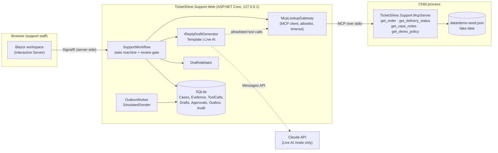
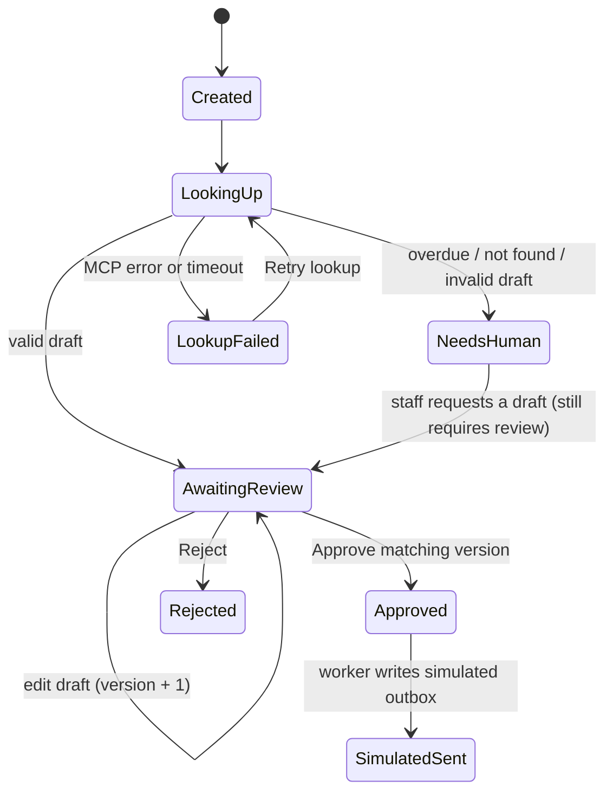

# Architecture

## Components

Key points:

- The agent/workflow touches order data **only via MCP**. SQLite stores only the workflow's own data (cases, drafts, audit), not order data.
- The MCP server has no state-changing tools. Sending replies is the workflow's job, and happens only after Approve.
- The model (Live AI) sees only the 4 lookup tools, and its output is only a draft that goes through `DraftValidator`.

## State machine

## Case flow

1. **Create case** → `SupportWorkflow.CreateCaseAsync` validates the order ID/message and saves the case as `Created`.
2. **Lookups** → `get_order` first. If not found or on error, **stop** with no further lookups (to avoid disclosing other data). Otherwise, call `get_delivery_status`, `get_case_notes`, `get_demo_policy`.
3. Store a **snapshot** of each result (JSON envelope) and a **trace** of each tool call.
4. **Classify** with `CaseClassifier` using DemoClock (default `2026-10-17T18:00:00Z`).
5. **Draft**: the generator returns `{subject, body, evidence_refs}`. The validator checks the referenced order, evidence refs, and length, then adds an escalation warning if needed. The recipient is taken from `order.customerEmail`.
6. Save draft v1; the case moves to `AwaitingReview`.
7. Staff edit (creating a new version), **Approve**, or **Reject**.
8. Approve: within **a single** `BEGIN IMMEDIATE` **transaction**, run `UPDATE Cases ... WHERE State='AwaitingReview' AND CurrentDraftVersion=@v`, insert `ApprovalEvents`, insert `OutboxMessages` (unique per case + version), and insert the audit entry.
9. `OutboxWorker` writes to `SimulatedMailbox` by idempotency key (`INSERT OR IGNORE`), then marks the outbox entry `Sent` and moves the case to `SimulatedSent`.

## Concurrency and idempotency

- Double-click: the button is disabled while processing; even if the request is repeated, the second one gets `Conflict` because the state has already changed.
- Two tabs approving at once: SQLite serializes writers, so only one conditional `UPDATE` succeeds. The other tab gets a conflict and reloads the state. The test `Concurrent_approvals_from_two_tabs_produce_one_success_and_one_message` runs 6 approvals in parallel.
- Stale version: approving v1 when v2 exists is rejected, so an old version is never sent.
- Re-running the worker multiple times never creates extra messages.

## Live AI mode

- Anthropic C# SDK, default model `claude-opus-5-5`, effort `medium`, structured JSON output (`subject`, `body`, `evidence_refs`).
- The tool loop is controlled by code: at most 6 tool calls, 60 seconds total, and lookups restricted to the case's own order.
- Server-side refusal fallback (beta `server-side-fallback-2026-07-01`, `fallbacks: "default"`) is on by default; disable it with `LiveAi:UseServerSideFallback=false` if the endpoint does not support it.
- The prompt states explicitly that customer messages and case notes are untrusted data. But safety **does not rely on the prompt**: tool permissions and the review gate are enforced in the backend.
