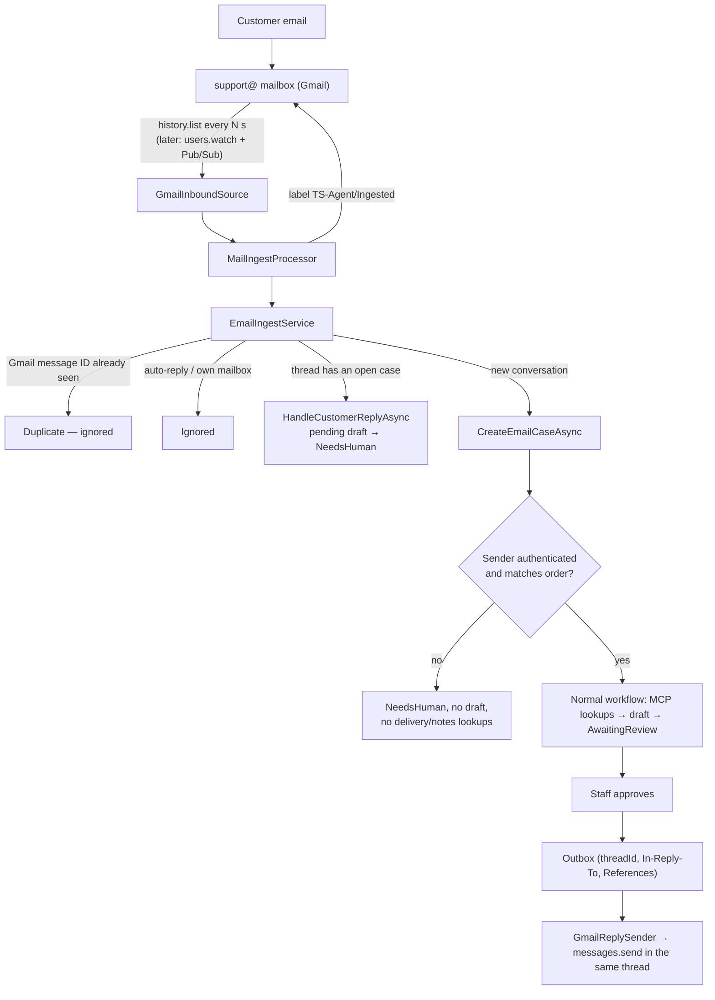

# Email channel (Gmail)

How customer emails become cases, and how to connect the real Ticket Shine Gmail mailbox.

## Flow



## Rules

| Rule | Why | Where |
|---|---|---|
| One case per Gmail message ID (`InboundMessages` primary key) | Polling and retries can deliver the same message twice | `SqliteCaseRepository.TryRecordInboundAsync` |
| Trust only `Authentication-Results` from `mx.google.com` | Senders can add their own fake headers | `AuthenticationResultsParser` |
| DMARC pass, or DKIM pass aligned with the From domain | SPF checks the envelope sender, not the visible From | `SenderAuthentication.IsAuthenticatedFor` |
| Sender must equal the order's customer email | An authenticated stranger must not get someone else's order details | `SupportWorkflow.SenderProblem` |
| No order number → search by sender only if authenticated | Prevents probing which addresses have orders | `SupportWorkflow.CreateEmailCaseAsync` |
| `find_orders_by_email` is not offered to the model | The model must not search arbitrary addresses | `AnthropicReplyDraftGenerator.ModelTools` |
| Ignore `Auto-Submitted` / bulk mail and mail from the support mailbox | Avoid reply loops | `EmailIngestService.IsAutomated` |
| Customer reply on an open thread → pending draft goes back to a human | The draft no longer answers the conversation | `SupportWorkflow.HandleCustomerReplyAsync` |
| Reply subject is `Re: <customer subject>` and includes `threadId`, `In-Reply-To`, `References` | Gmail only threads replies when these match | `SupportWorkflow`, `SqliteCaseRepository.ApproveAsync`, `MimeConversion.ToReply` |
| Reply Message-ID derived from the idempotency key; check `rfc822msgid:` before sending | A crash after sending must not send twice | `GmailReplySender` |

## Connecting the real Gmail mailbox

Ticket Shine needs:

1. **A Google Cloud project** with the **Gmail API** enabled.
2. **A service account** with a JSON key. Store the key outside the repository (user secrets, a mounted secret, or a key vault).
3. **Domain-wide delegation** (Google Workspace admin console → Security → API controls → Domain-wide delegation): add the service account's client ID with exactly these scopes:
   - `https://www.googleapis.com/auth/gmail.modify` (read messages, add the label)
   - `https://www.googleapis.com/auth/gmail.send` (send replies)
4. **The mailbox to impersonate**, for example `support@ticketshine.com`. Start with a **test mailbox**, not the live one.

Configuration (environment variables or user secrets; never commit the key):

```powershell
$env:Mail__Inbound = "Gmail"
$env:Mail__Outbound = "Simulated"        # keep simulated until inbound is verified, then "Gmail"
$env:Mail__PollSeconds = "30"
$env:Mail__SupportMailbox = "support-test@ticketshine.com"
$env:Mail__Gmail__ServiceAccountKeyPath = "C:\secrets\ticketshine-gmail-sa.json"
./scripts/run-demo.ps1
```

On the first poll the adapter stores the mailbox's current history ID and only processes mail that arrives **after** that. If the stored history ID expires, it resyncs with `Mail:Gmail:ResyncQuery` (default `in:inbox newer_than:2d`); duplicates are skipped.

Suggested rollout:

1. Inbound = Gmail, Outbound = Simulated, test mailbox. Check that cases appear and senders are classified correctly.
2. Outbound = Gmail on the test mailbox. Check that replies land in the right thread and that a restart does not send twice.
3. Only then point it at the live support mailbox. Staff login and authorization must exist first (see [limitations.md](limitations.md)).

## Later: push instead of polling

`users.watch` with a Cloud Pub/Sub topic notifies within seconds. The notification only carries a history ID, so it can simply trigger `MailIngestProcessor.RunOnceAsync()` instead of the timer; nothing downstream changes. Use a **pull** subscription to avoid exposing a public webhook, and renew the watch daily (it expires after 7 days).

## Status

| Part | Status |
|---|---|
| Simulated inbox → case → review → threaded reply (simulated) | Tested (unit/integration tests and headless browser) |
| Sender authentication, de-duplication, threading, auto-reply handling | Tested |
| `GmailInboundSource` / `GmailReplySender` | Tested against a **fake** Gmail REST API with the real Google client library. **Not yet run against a real mailbox.** |
| Pub/Sub push | Not implemented (polling only) |
